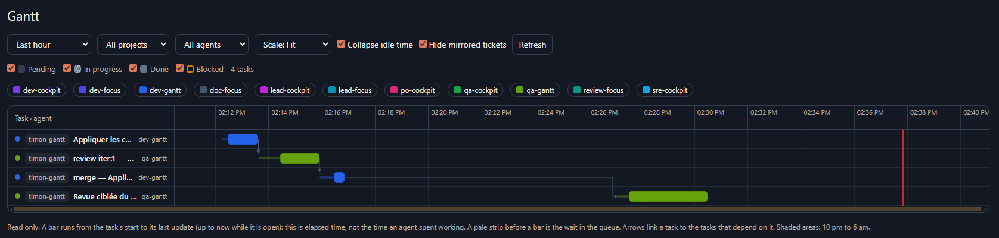

# Timon Gantt

A read-only Gantt timeline for the [Timon](https://timon-ai.com) Kanban. It adds a **Gantt** page next to the
Kanban in the side menu.



- **One bar per task**, from its creation (or first start, when Timon reports it) to its last update, or to *now*
  while it is open. A pale strip before a bar is the time the task waited in the queue.
- **Dependency arrows** from a task to the tasks that depend on it.
- **One colour per agent** (click an agent chip to filter on it); the status is in the bar style: solid = done,
  striped = in progress, pale = pending, orange ring around the bar = blocked.
- **Grafana-style period picker**: last 5, 15, 30 minutes, 1, 6, 12, 24 hours, 2, 7, 30 days, or all history.
- **Scales**: *Fit* (the drawn time fills the page, the default) or a fixed *Tight*, *Normal* or *Wide*.
- **Collapse idle time** (on by default): stretches with no activity become narrow hatched breaks labelled with
  their real length, so a day of work is not lost in a month of silence.
- Filters by project, agent and status (with all projects shown, each row starts with a project badge); mirrored tickets (from GitHub, Linear, Jira…) are hidden by default.
- Refreshes every 30 s (paused while the tab is hidden). The interface is in English and French, following
  Timon's language.

The official Kanban view cannot be extended with another display mode, so this is a separate page.

> **A bar shows elapsed time, not work time.** Timon records when a task was created and last updated, not
> how long an agent spent on it, and some later steps (a merge, a worktree cleanup) also touch `updated_at`.

## Requirements

- Timon with plugin API **15** or later (the page uses `@timon/ui`'s `NavLink` and `createTranslator`).
- Node.js 20 or later (the tests run with `node --test`, which works on 20 and newer), only to run the tests or to rebuild the page.
- **Developer mode**: this plugin is not signed, and Timon loads an unsigned plugin only in developer mode.
  Turn it on in *Settings › Plugins › Developer mode* (superadmin), or in `timon.config.json`
  (takes effect after a restart):

  ```json
  { "developer": { "unsignedPlugins": true } }
  ```

## Install from this repository

```sh
git clone https://github.com/thewhitewizard/timon-gantt.git
cd timon-gantt
timon plugin add .
```

`lib/client.js` (the page) is committed already built, so there is nothing else to run. The plugin is linked
from your working copy: Timon loads it within a second, with no restart. Then open **Gantt** in the side menu,
or go to `/gantt`.

- Check that it is active: `timon plugin list`.
- Update: `git pull`. If `src/` or `locales/` changed, run `npm install && npm run build` first
  (Timon serves `lib/client.js`, not `src/`).
- Remove: `timon plugin remove gantt` (the plugin stores nothing).

You can also build a package and install that: `npm pack`, then `timon plugin add ./thewhitewizard-plugin-gantt-0.1.0.tgz`.

## Permissions

- `kanban:read`: list the tasks the signed-in user is allowed to see. Nothing is written; no settings, no network
  access, no storage.

## Development

```sh
npm install
npm run build     # src/client.js + locales/*.json  ->  lib/client.js (esbuild)
npm test          # the time-axis maths (src/timeline.js) and the server half (lib/index.js)
timon plugin check .
```

| Path | What it is |
| --- | --- |
| `lib/index.js` | Server half: `GET /tasks`, asks Timon for the tasks status by status and flattens them |
| `src/timeline.js` | The time axis (stretches, breaks, ticks, nights, arrows, colours): pure, tested |
| `src/client.js` | The React page |
| `locales/en.json`, `locales/fr.json` | Texts. English is complete; add a language by adding `locales/<tag>.json` and importing it in `src/client.js` |
| `lib/client.js` | **Built** page, committed because Timon runs no build step when it installs a plugin |

## Known limits

- Timon lists at most 1000 tasks per call, sorted by priority (highest first) then age (oldest first). The plugin
  asks status by status, so open tasks are never pushed out by closed ones, and it shows a banner when a status
  reaches the limit: the missing tasks are then the most recent ones of low priority. The limit applies per
  status, so up to 4000 tasks can be shown; to see more, clear old tasks in Timon.
- A task's first start (`started_at`) is optional and undocumented in Timon. When it equals the last update of a
  closed task it is ignored, because older history copied `updated_at` into it.
- The project filter uses the project stored on the task; a task whose project only comes from its agent has none.
- Agent colours are stable for a given set of agents; adding an agent can move the colour of one that collided.

## Licence

[MIT](LICENSE). The idea is inspired by [Hermes Kanban Gantt](https://hermes-agent.nousresearch.com/marketplace/kanban-gantt)
(GPL-3.0); no code was taken from it.
